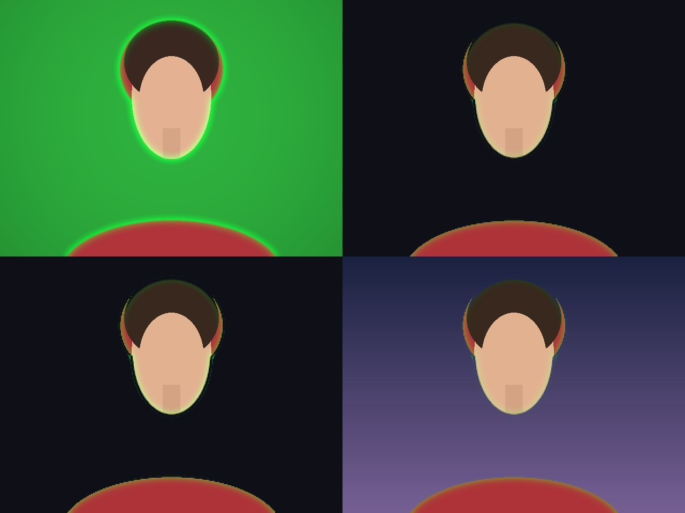
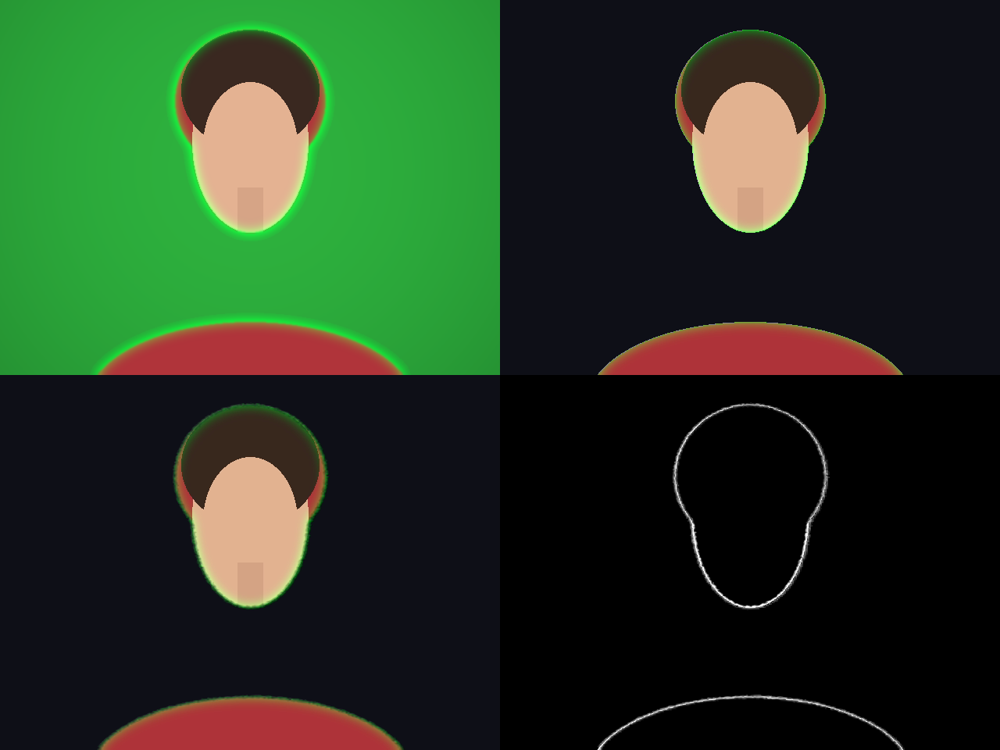
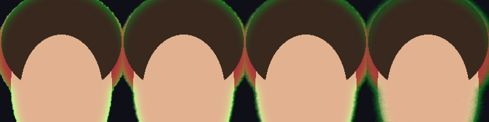
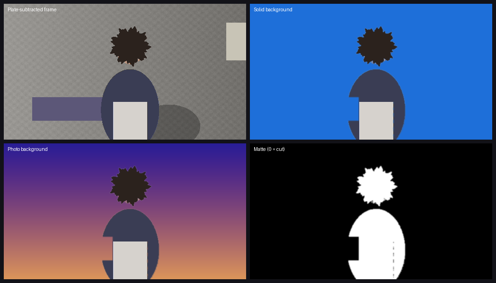

 <div align="center">

# Android Webcam Project

### Turn your Android phone into a high-quality webcam.

A free, open-source webcam solution featuring high-resolution video streaming, USB and Wi-Fi connectivity, and a virtual webcam for your desktop.

<br>

[](https://github.com/soubhagyajit/Android-Webcam-Project/releases)
[](https://github.com/soubhagyajit/Android-Webcam-Project/releases)

[](https://github.com/soubhagyajit/Android-Webcam-Project/releases)
[](https://github.com/soubhagyajit/Android-Webcam-Project/releases)

<br>


[](https://github.com/Linli1221/Android-Webcam-Project/actions/workflows/android.yml)
[](https://github.com/Linli1221/Android-Webcam-Project/actions/workflows/checks.yml)


<br>

[**Google Play**](https://play.google.com/store/apps/details?id=com.soubhagyajit.awa) · [**Releases**](https://github.com/soubhagyajit/Android-Webcam-Project/releases) · [**Report a Bug**](https://github.com/soubhagyajit/Android-Webcam-Project/issues) · [**Contribute**](https://github.com/soubhagyajit/Android-Webcam-Project/pulls)

</div>

---

> [!IMPORTANT]
> **A milestone achieved!**
>
> AWA (Android Webcam App) is now officially available on Google Play.

## Latest Releases

Two independent applications work together to provide the complete Android Webcam experience.

<table>
<tr>
<td width="50%" align="center" valign="top">

### AWA
**Android Webcam App**

📱 Android · Mobile

The mobile application turns your Android phone into a high-quality video streaming server.

<br>

[](https://github.com/soubhagyajit/Android-Webcam-Project/releases)

<br><br>

<a href="https://play.google.com/store/apps/details?id=com.soubhagyajit.awa">

</a>

<br>

[View Releases](https://github.com/soubhagyajit/Android-Webcam-Project/releases)

</td>
<td width="50%" align="center" valign="top">

### AWC
**Android Webcam Client**

💻 Desktop · Windows

The desktop client connects to your phone and provides a virtual webcam device for your favourite applications.

<br>

[](https://github.com/soubhagyajit/Android-Webcam-Project/releases)

<br><br>

<a href="https://github.com/soubhagyajit/Android-Webcam-Project/releases">

</a>

<br><br>

[View Releases](https://github.com/soubhagyajit/Android-Webcam-Project/releases)

</td>
</tr>
</table>

---

## About the Project

**Android Webcam System** is an open-source project that transforms an Android smartphone into a webcam for desktop computers.

It consists of two independently developed components:

- **AWA (Android Webcam App):** A Kotlin-based Android application responsible for capturing and streaming video.
- **AWC (Android Webcam Client):** A Tauri-based desktop application that connects to the phone and provides virtual webcam functionality.

The system supports both USB and Wi-Fi connections, giving users flexibility between low-latency wired connectivity and wireless convenience.

## What's Included

| Component | Technology | Platform |
|:---|:---|:---|
| AWA – Mobile App | Kotlin | Android |
| AWC – Desktop Client | Tauri | Windows |
| Video Streaming | H.264 / RTSP, MJPEG | USB / Wi-Fi |
| Virtual Webcam | Softcam | Windows |

## Features

### AWA – Android Webcam App

- Up to **4K video resolution**, depending on device capabilities.
- Front and rear camera switching.
- Manual and automatic focus controls.
- Exposure control.
- Zoom and camera lens switching.
- **Background removal** — a green/blue screen keyer (Vulkan compute, with a CPU fallback), a person segmentation model when there is no screen at all, *or* a background plate shot of the empty room; background replaced with a colour or a photo before the frame is encoded.
- USB and Wi-Fi connection modes.
- Real-time connection status.
- Optimized battery usage.

**Planned**
- Adjustable frame rate (15, 30 and 60 FPS).

### AWC – Desktop Client

- Virtual webcam device.
- Compatible with Zoom, Microsoft Teams, Google Meet, OBS Studio, Discord and more.
- Clean, modern user interface.
- Connection statistics.
- USB and Wi-Fi connectivity.

### Connection Modes

| USB Mode | Wi-Fi Mode |
|:---|:---|
| Lower latency | Wireless convenience |
| More stable connection | Flexible positioning |
| No Wi-Fi required | Works over a shared network |

---

## Screenshots & Demonstrations

*Screenshots and demonstrations will be added here.*

<!-- Add screenshots using:


-->

---

## Installation & Requirements

### System Requirements

| Requirement | Minimum |
|:---|:---|
| Desktop OS | Windows 10 or newer |
| Mobile OS | Android 8.0 or newer |
| Mobile Device | Android phone with a compatible camera |

**Coming to:** Linux (development in progress) and macOS (planned).

### Getting Started

1. Install AWA from [Google Play](https://play.google.com/store/apps/details?id=com.soubhagyajit.awa).
2. Download and install AWC from the [GitHub Releases](https://github.com/soubhagyajit/Android-Webcam-Project/releases) page.
3. Connect both your phone and computer to same Wi-Fi or use a USB cable.
4. Launch both applications and establish the connection.
5. Select the Android Webcam virtual camera in your preferred video application.

---

## Using as a Virtual Webcam

AWC creates a virtual webcam device that can be selected in applications such as:

- Zoom
- Microsoft Teams
- Google Meet
- Discord
- OBS Studio
- Any application that supports webcam input.

### Windows Setup

The virtual webcam should appear automatically in supported video applications.

---

## Configuration

### Video Resolution

Available resolution options depend on your Android device's camera capabilities.

| Resolution | Dimensions | Recommended Usage |
|:---|:---|:---|
| 480p | 640 × 480 | Low bandwidth |
| 720p | 1280 × 720 | Older devices |
| 1080p | 1920 × 1080 | High-quality streaming |
| 4K | 3840 × 2160 | Maximum supported quality |

Change the resolution through the mobile application settings or the relevant configuration in the source code.

### Background Removal

Enabled from the phone's settings panel while the stream type is **MJPEG**. The work happens on the
phone, on the raw NV21 frame, before JPEG encoding: no alpha channel is involved and the desktop
client needs no change.

**A green screen is optional.** Three engines share the compositor and the replacement background:

| Mode | Engine | Wins when |
|:---|:---|:---|
| `chroma` | Chroma key - Vulkan or CPU | there is a real screen: the edge follows the colour boundary, so hair, motion blur and semi-transparent edges survive |
| `person` | ML Kit selfie segmentation | there is no screen: a wall, a room, a busy office |
| `plate` | Background plate subtraction | no screen but the phone is on a tripod: shoot the empty room once and the matte follows the real silhouette, hair included |
| `auto` (default) | screen or person, whichever the frame calls for | the user should not have to know which one applies |

`auto` decides from the *border* of the frame: a coloured screen fills the border, a room does not.
It re-checks roughly every two seconds and needs two agreeing probes before switching, so a green
object entering the shot cannot flip the stream back and forth.

#### Chroma key controls

| Control | What it does |
|:---|:---|
| Key colour | Green or blue screen; used as the starting point and fallback |
| Similarity | How much colour difference still counts as screen |
| Soft edge | Width of the alpha ramp, keeps hair and shoulders from looking cut out |
| Spill removal | Removes the green cast the screen bounces onto the subject |
| Background | Solid colour, or a photo picked with the system picker |

The key colour is re-sampled from the border of the frame a few times per second, so unevenly lit
screens still key out. The same settings are reachable over HTTP — see `/help` on the device.

#### Person mask controls

| Control | What it does |
|:---|:---|
| Cut | Foreground threshold of the model's confidence; moves the edge in or out |
| Edge softness | Width of the alpha ramp around the cut |
| Stabilise | Averages consecutive masks - less flicker, a little more lag |

The model runs **asynchronously** and the mask trails the frame by one or two frames. Inference
takes 25-65 ms, so waiting for it inside the capture loop would halve the frame rate; instead each
frame is composited against the newest mask available, and frames that arrive while a request is
still in flight are dropped rather than queued. Compositing stays on the CPU: the mask is 256×256
and arrives at 15-30 Hz, so uploading it to the GPU every frame would cost more in synchronisation
than the compositing itself.

Limits worth knowing: segmentation finds **one person** - it does not key objects, pets or a second
person - and the bundled model adds about 4.5 MB to the APK. It is bundled rather than delivered
through Play Services precisely so it also works on phones without Google Play Services. Unlike the
chroma path, it does not remove green spill, because there is no screen to bounce light.

The segmenter's mask is in the *upright* frame while the sensor buffer is not, so on a phone held in
portrait the two differ by 90 degrees. The frame is resampled into an upright 256×256 NV21 for
inference, and the returned mask is rotated once into sensor orientation before compositing - which
is what keeps the per-pixel step a plain axis-aligned upsample.

`AWA/tools/chroma_reference.py` holds a Python mirror of the keyer, and
`AWA/tools/mask_composite_check.py` checks the segmentation half: the rotations against numpy's own,
and the composite against a ground-truth silhouette.

```bash
python AWA/tools/chroma_reference.py       # chroma keyer reference sheet
python AWA/tools/mask_composite_check.py   # rotation + mask compositing
```

#### Background plate (no screen, no model)

Press **Capture** in the plate section while the scene is empty, and step out of the frame. Three
frames are averaged into the plate, which is then subtracted from every following frame - so the
matte follows the real silhouette instead of a 256×256 model mask, and it does not care whether the
wall behind you is white, cluttered or brick. It only cares that nothing moves.

| Control | What it does |
|:---|:---|
| Sensitivity | Trades leftovers of the room against keeping clothes and hair that match the wall |
| Edge softness | Width of the alpha ramp at the silhouette |
| Stabilise | Averages consecutive mattes - less flicker, a little more lag |

What it does per frame:

| Stage | Why |
|:---|:---|
| Exposure estimate | The median luma shift over pixels whose chroma still matches the plate. Without it, the subject walking in makes the AE dim the room and the whole wall becomes foreground |
| Two-axis difference | Score is the larger of the normalised luma and chroma distances - luma alone cannot separate a shadow from a dark sleeve, chroma alone is blind to a white shirt against a white wall |
| Shadow rejection | A shadow scales the light, and chroma is measured against luma, so `(u-128)/y` and `(v-128)/y` do not move under one - that, plus a brightness ratio window, separates "wall in shade" from "dark trousers" |
| Slow re-learning | Background pixels creep 1/32 towards the live frame, so a lamp switched on stops being a hole after a couple of seconds |

Limits worth knowing: the camera must **stay put** (a bumped tripod means re-capture, and a change of
resolution or lens drops the plate automatically), the plate lives in memory only, and an object at
50-95% of the wall brightness *with the wall's exact hue* is indistinguishable from a shadow - below
50% it is always kept, which is the safer half of that trade.

Measured on a synthetic room (textured wall, ragged hair, white shirt, cast shadow, 512×288):
IoU 0.997 against the true silhouette, 0.1% of the wall left behind, and the cast shadow reads as
0.5% alpha instead of being blended into the replacement background. A one to four pixel wobble of
the camera leaks under 1% of a *smooth* wall; a high-contrast background (bookshelf, brick) is a
different story, because every edge of it moves - that is what the "keep the phone still" note is
about.

```bash
python AWA/tools/plate_check.py   # exposure estimate, IoU, shadow rejection, flicker, composite
```

#### Vulkan compute backend (chroma key)

The keyer runs on the GPU by default. `AWA/app/src/main/cpp` holds a small Vulkan 1.0 compute
implementation; the Kotlin side ([`ChromaKey.kt`](AWA/app/src/main/java/com/soubhagyajit/awa/processing/ChromaKey.kt))
picks the backend and keeps the CPU version as a transparent fallback.

| | |
|:---|:---|
| Pass 1 (`chroma_key_y.spv`) | Four luma bytes per invocation; alpha comes from the 2×2 chroma cell |
| Pass 2 (`chroma_key_uv.spv`) | Two chroma cells per invocation, plus the border sampling for the key colour |
| Memory | Host visible + coherent, persistently mapped — the frame is copied straight in and out, no staging buffers |
| Allocations | None per frame; the command buffer is recorded once per frame size |

The two passes each write whole 32-bit words of the NV21 buffer, which is why the GPU path requires
a width that is a multiple of 4 (all camera modes here are). Anything else, a device without Vulkan,
a driver that rejects the shaders, or a failed dispatch drops back to the CPU keyer — the settings
panel shows which one is live, and `chroma_key_gpu` in `/settings` selects it by hand.

The SPIR-V blobs are committed under `AWA/app/src/main/assets/shaders`. After editing a `.comp`
file, regenerate them (no Vulkan SDK needed, glslang is used as WASM):

```bash
cd AWA
npm install --no-save @webgpu/glslang
node tools/build_shaders.mjs
```

Building the app now requires the NDK and CMake, which Android Studio installs on demand.

Two checks in `AWA/tools` keep the shaders honest without a phone at hand:

```bash
python AWA/tools/chroma_gpu_check.py   # emulates both shaders, compares with the CPU reference
python AWA/tools/check_spirv.py        # SPIR-V 1.0, entry point, bindings 0..4 and their kinds
```



*Synthetic scene with uneven screen lighting and green spill. Top-left: original. Top-right: keyed
onto a solid colour. Bottom-left: same with spill removal off. Bottom-right: keyed onto a photo.*



*The same scene treated as an ordinary background (no screen assumed), with a deliberately soft and
noisy stand-in for the model's mask. Top-left: sensor frame, unrotated. Top-right: ideal composite
from the ground-truth silhouette. Bottom-left: the pipeline under test. Bottom-right: the difference
between the two, amplified 4x - the error is the 1-2 pixel silhouette, nothing else. The green rim is
in the source image, not added by the composite: the person path deliberately does not despill.*



*Edge softness 0.03, 0.12, 0.2 and 0.45 on the same crop. The 256×256 mask is upsampled bilinearly,
so the ramp is smooth at every setting - no blocky steps from the mask's own resolution.*



*A room with no screen at all, keyed by plate subtraction: the poster, the table edge and the cast
shadow on the right all belong to the plate and disappear, while the ragged hair silhouette survives
at full resolution. The matte is one byte per pixel - nothing is downsampled to a model grid.*

---

## Building from Source

### Prerequisites

- Android Studio – for Android development.
- Node.js and Yarn – for the desktop frontend.
- Rust toolchain – for Tauri development.
- Visual Studio C++ Build Tools – for Windows desktop builds.

You can use VS Code or your preferred development environment.

### Build AWC – Desktop Client

```bash
cd CLIENT/tauri-client

# Install dependencies
yarn install

# Build the Windows application
yarn tauri build
```

### Build AWA – Android App

Open the Android project in Android Studio, configure the Android SDK and required dependencies, and build the application using Gradle.

The background removal needs the NDK (28.2, AGP 9.2's default) and CMake 3.22.1, both of which
Gradle downloads on the first build - no Vulkan SDK and no shader compiler are required, because the
SPIR-V blobs are committed under `app/src/main/assets/shaders`.

### Continuous integration

| Workflow | Runs on | Does |
|:---|:---|:---|
| `android.yml` | push to `master`, pull requests, tags | `assembleDebug` + unit tests, uploads `awa-debug-apk`; on a `v*` tag it also attaches the APK to the release |
| `checks.yml` | changes to `AWA/tools`, the shaders or the native module | the CPU mirrors and the SPIR-V descriptor check, in seconds |

The APK from a run is on the run page under **Artifacts**. It is debug-signed, so it installs without
a keystore - which is why the release job ships the debug build rather than an unsigned release one.
To cut a release:

```bash
git tag v1.0.5
git push origin v1.0.5
```

---

## Troubleshooting

### Connection Issues

**Unable to connect?**

- Check your firewall settings.
- Allow the default ports `8080` and `8554` where applicable.
- Ensure both devices are connected to the same Wi-Fi network in Wi-Fi mode.
- Verify USB debugging is enabled in USB mode.
- Check the connection status in both applications.

### Video Quality Issues

- Lower the resolution to 720p or 480p.
- Prefer USB connectivity for a more stable connection.
- Close other applications accessing the camera.
- Use a 5 GHz Wi-Fi network where available.

---

## Why Android Webcam Project?

| Feature | Android Webcam Project | Typical Alternatives |
|:---|:---:|:---:|
| Price | Free | Varies |
| Resolution | Up to 4K | Often limited in free tiers |
| Open Source | Yes | Often proprietary |
| USB Support | Yes | Varies |
| Wi-Fi Support | Yes | Yes |
| Customization | Full source access | Often limited |
| Privacy | Self-hosted streaming | Varies |
| Advertisements | No | Varies |

*Comparison is indicative and may vary depending on the alternative application and its pricing tier.*

---

## Sponsorship & Support

> [!NOTE]
> **Help bring Android Webcam Project to Apple platforms!**
>
> Android Webcam Project currently supports Android and Windows. Expanding to iOS and macOS is one of the project's ambitions.
>
> Apple development requires access to macOS hardware for building, testing and maintaining the applications.
>
> Sponsorships will help fund the hardware required to bring these platforms to life.

<div align="center">

### Support the Development

<a href="https://ko-fi.com/R5O327R68W">

</a>

</div>

---

## Contributing

Android Webcam Project is open source, and contributions are welcome!

You can contribute by:

- 🐛 Reporting bugs and issues.
- 💡 Suggesting new features.
- 🔧 Submitting pull requests.
- 📖 Improving documentation.
- ⭐ Starring the repository.

Please use [GitHub Issues](https://github.com/soubhagyajit/Android-Webcam-Project/issues) to report problems or suggest improvements.

---

## Roadmap

The following are some of the planned improvements and upcoming features.

- [ ] Stream while the phone screen is off or locked (currently only dim mode is available).
- [ ] Background service support.
- [ ] Further UI and layout optimizations.
- [ ] Audio streaming support.
- [ ] Recording functionality.
- [x] Android application published on Google Play.

[View all releases](https://github.com/soubhagyajit/Android-Webcam-Project/releases)

---

## License

This project is licensed under the **GNU General Public License v3.0 (GPL-3.0)**.

Copyright © 2026 Soubhagyajit Borah.

Under GPL-3.0:

- You are free to use, modify and distribute the software.
- Commercial use is permitted.
- Distributed modified versions must disclose their source code.
- Derivative works must retain the GPL-3.0 license.

See the [LICENSE](LICENSE) file for the complete terms.

---

## Acknowledgments

- Virtual camera functionality powered by [Softcam](https://github.com/tshino/softcam) by tshino (MIT License).
- Built with Kotlin and Tauri.
- Inspired by DroidCam and similar webcam solutions.
- Made with ❤️ for the open-source community.

---

<div align="center">

### Enjoying Android Webcam Project?

If this project is useful to you, consider giving it a ⭐ on GitHub. Every star, contribution and piece of feedback helps the project grow.

<br>

**Happy Streaming!**

Made with ❤️ and ☕ by developers, for developers.

<br>

[](https://ko-fi.com/R5O327R68W)

</div>
